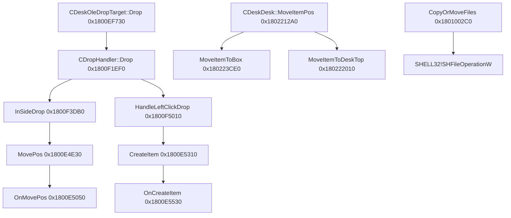

# DeskGo 4.3.1832.127 静态分析记录

分析对象：`E:\download\DeskGo_4_3_1832_127_full_S20000.exe`。本次只读取、切分、解压和反汇编，没有启动安装包或执行其中的程序。

外层安装包 SHA-256：`6d3789f2ac124df0a554e64afaf5bc900ad785c655ffe994c47b052ad8805b72`，212,682,984 字节。

## 工具和覆盖范围

REA 6.8.0 的 PE 导入表、导出表、托管元数据识别可用。当前 Ghidra / IDA / Kuna 未配置，Hopper 不支持该 Windows 主机，Rizin 未安装。REA 对外层 PE 资源解析报告 section raw bytes overlap headers，不能据此给出完整资源树。

补充工具为现有 Bandizip `E:\Bandizip\bz.exe` 和 Visual Studio 18 的 `dumpbin.exe`。前者只做归档读取/解压；后者静态反汇编真实载荷，不运行目标代码。

函数地址来自 Features64.dll 的 PE `.pdata` / RUNTIME_FUNCTION 范围；函数标签由函数内引用的日志字符串推导。它们不是恢复的 PDB 符号。一个日志名可能出现在内联代码或多个异常处理片段中。只报告反汇编中直接可见的 call / 跨函数 jmp 和 IAT 调用，虚调用、回调和没有 `.pdata` 的叶函数尚不完整。

## 安装包和程序类型

外层是 x86 PE32，节名 `UPX0` / `UPX1`，含 `UPX!` 标记；这支持 UPX 压缩包装判断。直接读取外层导入表只能看到加载器的一小部分 API，不能用作产品主体依赖表。

按起始头 CRC 和 next-header CRC 验证后，发现三个内嵌 7z：

| 起始文件偏移 | 字节长度 | 内容 |
| --- | ---: | --- |
| 2,937,358 | 54,228 | QMFile 启动插件 |
| 2,991,594 | 207,486,712 | 主载荷，248 文件，展开合计 733,236,277 字节 |
| 210,478,314 | 2,193,877 | x86 / x64 VC 运行库包 |

`bz l 原安装包` 只显示第一个小包；因此必须先切出主载荷，再分析里面的程序。复现信息在 `archive-offsets.json`，切分代码在 `extract_payloads.py`。

主载荷同时提供 x86 / x64 原生程序。核心入口包括 `DesktopMgr.exe` / `DesktopMgr64.exe`，主要业务在 `Features.dll` / `Features64.dll`；另有 DesktopService、Shell 扩展、MiniSkinCore、Qt5 和 CEF 组件。整个产品包含 Qt/CEF 不代表桌面拖拽主路径由 JavaScript 实现。

REA 对 `Features64.dll` 的 CLI 元数据检查确认 CLI directory 缺失，分类为 not-managed；观察到 MSVC RTTI 类型名、VC140 运行库导入，支持原生 C++ 实现判断。

| 载荷 | SHA-256 | REA 导入覆盖 |
| --- | --- | --- |
| DesktopMgr64.exe | `cd299c01e27dd86f281ef31d8fe5590b89cce3acd2c05e82637c351d3511ed60` | 22 DLL / 283 函数，complete |
| Features64.dll | `a5ee9e945725508fa19ddb1478e780977da397747e856669058eeda82b02c949` | 38 DLL / 1151 函数，complete |
| DesktopService64.exe | `a21f7138c2a0dd5115ab3e55bfbb55baa70680a6cc53be181e4346301d3c8bb5` | 24 DLL / 261 函数，complete |
| MiniSkinCore64.dll | `af58cca315141daf05a773aee835df849a7d39a3c2ff0112162fb56c209e2e82` | 24 DLL / 228 函数，complete |

完整导入名和 IAT RVA 保存在 `imports.json`，其中保留 REA Evidence ID。

Features64.dll 的非 CRT DLL 包括 msi、COMCTL32、WS2_32、KERNEL32、SHLWAPI、PSAPI、dwmapi、CRYPT32、USER32、GDI32、ADVAPI32、SHELL32、ole32、OLEAUT32、gdiplus、bcrypt、WSOCK32、WININET、VERSION、MSIMG32、IMM32、WTSAPI32 和 pdh。

与桌面相关的实际导入：

- OLE 拖放：`RegisterDragDrop`、`RevokeDragDrop`、`DoDragDrop`、`ReleaseStgMedium`、`CoMarshalInterThreadInterfaceInStream`。
- 窗口和绘制：`GetCursorPos`、`SetCapture`、`ReleaseCapture`、`SetWindowPos`、`MoveWindow`、`UpdateLayeredWindow`、`BitBlt`、`RedrawWindow`。
- 多屏：`EnumDisplayMonitors`、`EnumDisplayDevicesW`、`EnumDisplaySettingsW`、`GetMonitorInfoW`、`MonitorFromPoint`、`MonitorFromRect`。
- 文件和 Shell：`SHFileOperationW`、`SHGetFileInfoW`、`SHParseDisplayName`、`DragQueryFileW`、`MoveFileExW`、`CopyFileW`。

`GetDpiForMonitor` 还以字符串形式出现，可能是动态解析入口；仅字符串存在不能证明该 API 在某场景执行。

## 定位到的移动主路径

以下都是 Features64.dll 的首选加载 VA（image base `0x180000000`）。实际运行启用 ASLR 时需要加模块基址差值。

| 日志推导标签 | VA | 证据和作用 |
| --- | --- | --- |
| Frame::CDeskFrameWndUI::DragBox | `0x180158A30` | 从 `0x180158AB8` 调 GetCursorPos；计算新矩形并查缓存屏幕记录；到位置更新 helper |
| Frame::CDeskFrameWndUI::DragBoxStop | `0x180158EA0` | 设备 key / 屏幕检查、最终位置和屏幕参考信息处理 |
| CDeskDropHelper::MovePos | `0x1800E4E30` | 检查当前线程，直接执行 OnMovePos 或构建 runnable 分派 |
| CDeskDropHelper::OnMovePos | `0x1800E5050` | 构造待移动路径列表、通知状态、经对象虚接口提交 |
| CDeskDesk::MoveItemPos | `0x1802212A0` | 直接调用 MoveItemToBox / MoveItemToDeskTop 分支 |
| CDropHandler::CopyOrMoveFiles | `0x1801002C0` | 真实文件操作，直接 IAT 调用 SHFileOperationW |

观察到的直接调用关系：



没有画出 `OnMovePos -> CDeskDesk::MoveItemPos` 边：`0x1800E5286` 是虚调用 `call r10`，本次尚未解析其运行时对象。`MoveItemPos` 与 `CopyOrMoveFiles` 也不能因名字相似就连接。完整的已知地址/直接边在 `functions.csv`（48 个选定函数范围）和 `named-call-edges.csv`。

`DragBox` 在 `0x180158B0F` 到 `0x180158B9B` 一段对位移与常量 8 做比较，配合吸附状态字段清除和坐标修正。可推导它包含吸附脱离滞回，不能把这直接说成系统拖拽起始阈值。它还在 `0x180158C59` 起读取已有屏幕记录并检查矩形角点；这段是内存几何运算。最终在 `0x180158E20` 调位置更新 helper，在 `0x180158E64` 调 UpdateWindow。未分析所有下游 helper，不能声称整条路径绝无阻塞。

`MovePos` 在 `0x1800E4E79` 调 GetCurrentThreadId，与对象保存的线程 ID 比较；匹配时在 `0x1800E4E93` 直接调用 OnMovePos，不匹配时复制路径/POINT/DROPINFO，构建 runnable，`0x1800E501D` 调分派 helper。静态代码和相应 Runnable RTTI 支持线程归属/任务分派设计判断；本次没有运行观察它的队列延迟或线程调度。

## 多屏和热插拔路径

`Frame::CBoxMultScreenLayoutMgr::SysResolutionChangeNotify` 位于 `0x180128000`，观察到以下顺序：

1. `0x180128078` 调 `SysResolutionChangeToAddScreen` (`0x180128DE0`)。
2. `0x180128083` 调 `SysResolutionChangeToChangeBoxRc` (`0x180128120`)。
3. `0x18012808B` 调 `SysResolutionChangeToCheckInvalidBox` (`0x180129060`)。
4. `0x1801280B3` 调 `CMultiScreenHelper::UpdateOldTaskBarVirtualScreenInfo` (`0x18011ECE0`)。

`ChangeBoxRc` 有直接边到 `ReCheckFileBoxInitPostion` (`0x180126360`)、`SwapBoxBetweenTwoScreen` (`0x18012C440`)、`EnsureBoxMigratedOnScreen` (`0x18012DCC0`) 和 `FindPlaceForAnyBoxX` (`0x18012F110`)。

`SwapBoxBetweenTwoScreen` 在 `0x18012C684` 到 `0x18012C6AA` 对旧/新参考尺寸做双精度比例除法，后续缩放相对位置/尺寸，并做最小尺寸与越界检查，`0x18012CAFE` 起加回目标屏幕原点。此处支持“相对屏幕参考布局，切换屏幕后重新物化并修正”的设计判断，不能证明完整混合 DPI 语义。

日志和数据名还保留 `BoxListScreenInfo`、`SaveFencesBoxScreenInfo`、`ResetBoxAttachScreenInfo`、`FRAMEEVTPARAM_BOXREFERENCE_POS_X/Y`，与按屏幕维护布局的设计一致；它们本身不证明断电时不会覆盖离线布局。

`GetTaskBarEdgeSizeInternal` (`0x18011F420`) 将任务栏查询放到 `_beginthreadex` 创建的任务，在 `0x18011F5AB` 设置等待 0x320（800ms），超时分支读取已有缓存。这个函数仍可能让调用线程等待最多800ms，因此只能借鉴缓存和超时边界，不能照搬到本项目拖拽帧路径。

## 对当前项目的应用边界

可借鉴的是职责拆分：拖动帧只更新内存几何；落点提交和真实文件操作分离；显示器拓扑稳定后统一处理屏幕相对布局和越界纠正；任务栏/Shell 查询有缓存。没有把逆向伪代码或目标产品的二进制复制进本项目。

本报告不能保证 DeskGo 或当前项目在所有硬件组合下零闪烁、零卡顿。静态证据不包含帧耗时、多屏断电/重连回放、Explorer挂起测试或无限场景证明；这些需要对当前项目的构建和真实硬件交互验证。

## REA Evidence

- DesktopMgr64 imports：`ev_a83f42d4c85d6114a0ff13398c588d2a9518887f4b0a04daadcd84f360295bea`
- Features64 imports：`ev_4c7264f59fc299a84077c4483dfda4c7c94f9bdc2db100dc61fd986ad170d091`
- DesktopService64 imports：`ev_cf568f0f2f8a5d9a84e2253fba4b703373304c2f5d53b3530aa6eb504d35e32d`
- MiniSkinCore64 imports：`ev_52b639999ab7b5a3d822e043bf8a4bdf0800e4f176234d3650abc2576f5fd556`
- Features64 exports parent（368条）：`ev_dc930c118c3ce7d9ce5dbf2c65a1312c826be662e2dfbc5c9aba4de728d3c56f`
- Features64 managed classification parent：`ev_9f98243cb180d4d60ce0873c5713e0221ddfa236126d22fc1ec7937db9b4c2ea`

局部函数图来自补充工具 dumpbin + PE 格式解析，属于独立静态分析，不冒充 REA 反编译输出。

## 复现

```powershell
python artifacts\deskgo-rea\extract_payloads.py
& 'E:\Bandizip\bz.exe' l artifacts\deskgo-rea\payload-2991594.7z
& 'E:\Bandizip\bz.exe' x -y '-o:artifacts\deskgo-rea\extracted' artifacts\deskgo-rea\payload-2991594.7z 'Install_BinFinal\Features64.dll' 'Install_BinFinal\DesktopMgr64.exe' 'Install_BinFinal\DesktopService64.exe' 'Install_BinFinal\MiniSkinCore64.dll'
& 'C:\Program Files\Microsoft Visual Studio\18\Community\VC\Tools\MSVC\14.51.36231\bin\Hostx64\x64\dumpbin.exe' /nologo /disasm:nobytes '/out:artifacts\deskgo-rea\Features64.disasm.txt' artifacts\deskgo-rea\extracted\Install_BinFinal\Features64.dll
python artifacts\deskgo-rea\analyze_calls.py
```

完整安装包、解压二进制、归档和108MB反汇编输出由本目录 `.gitignore` 忽略，保留本机复查。外层安装包原始 REA 证据在 `evidence.json`，提取载荷的原始 REA 证据在 `payload-evidence.json`；两者来自独立 REA 会话。`imports.json` 提供可随源码审核的紧凑导入证据。
